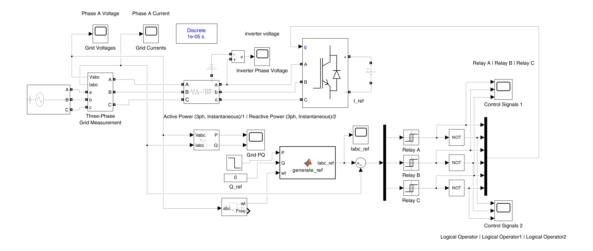
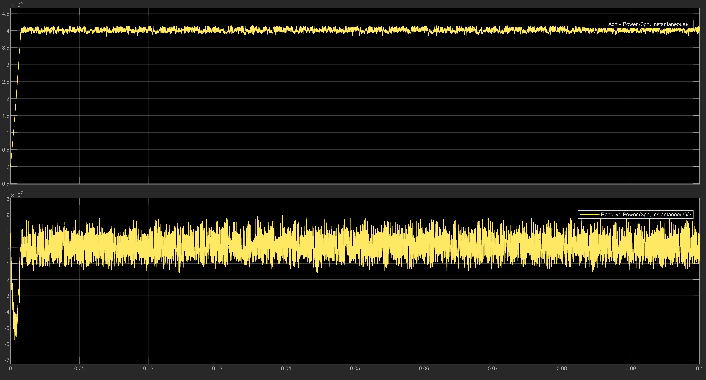
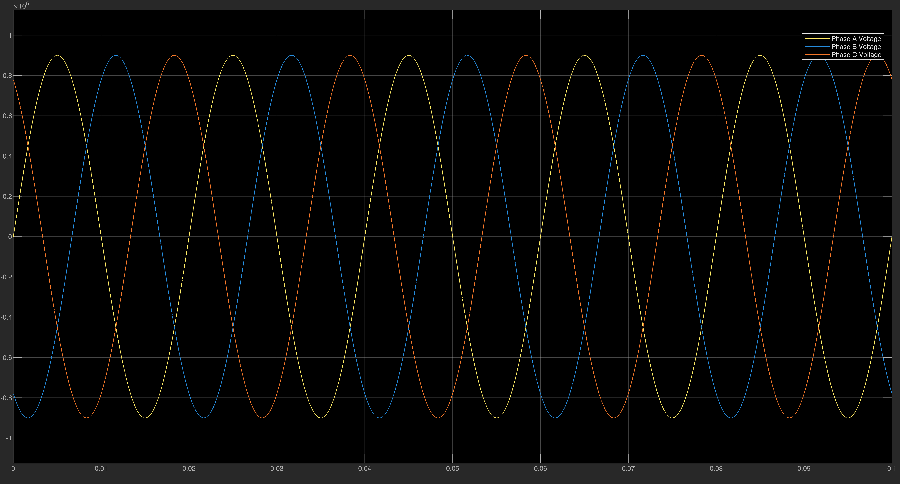
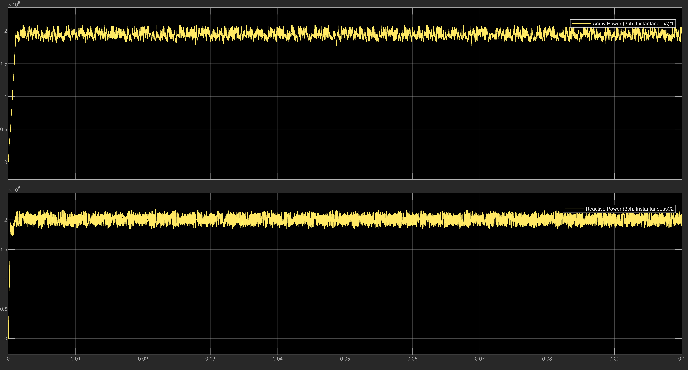
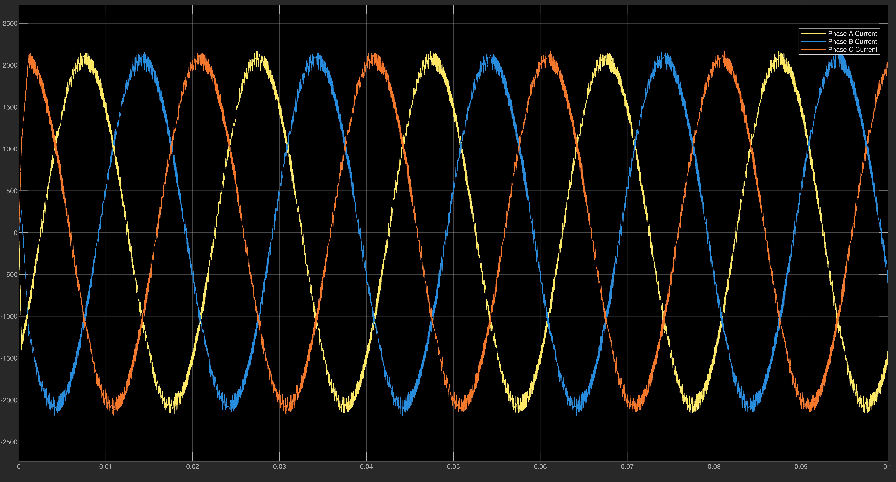
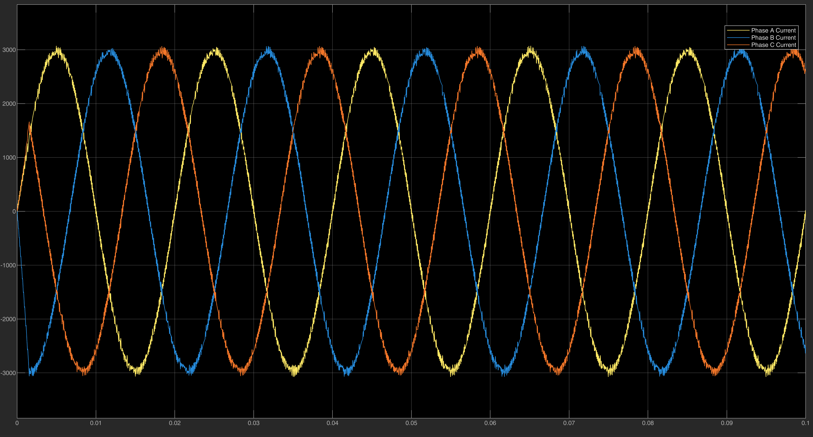
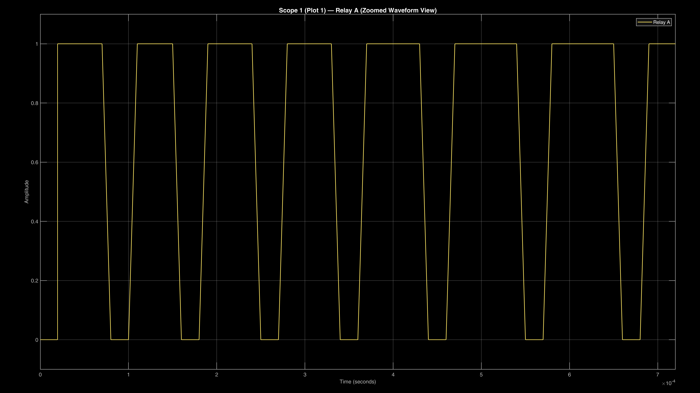
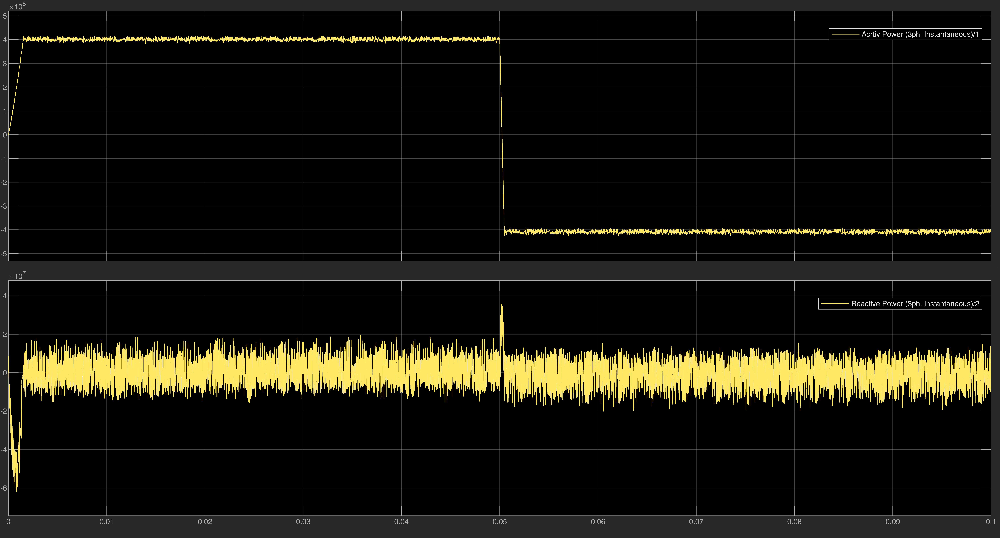
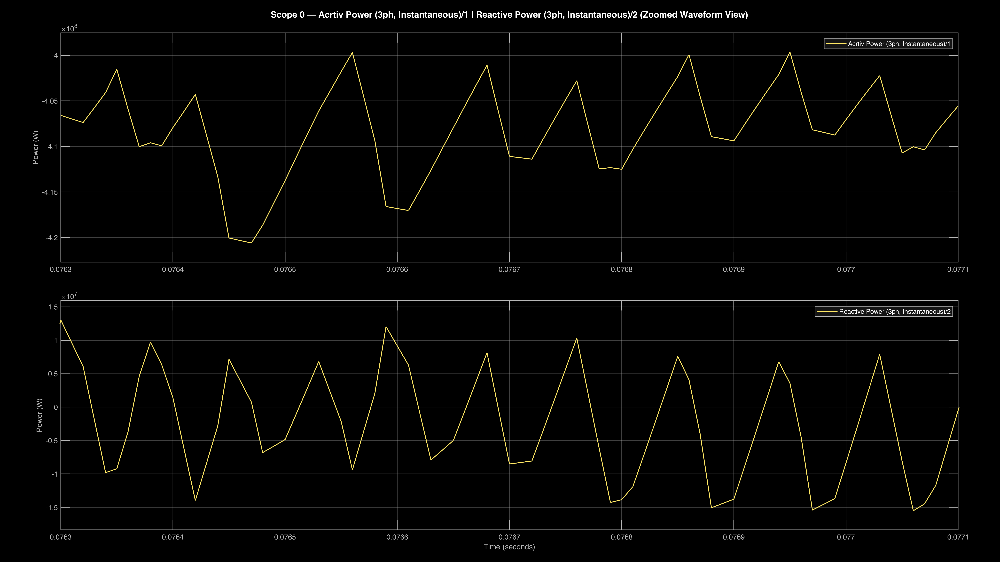

# Grid-Connected Two-Level VSC for HVDC Transmission: Hysteresis Current Control & Four-Quadrant P-Q Decoupled Regulation

<p align="center">
  
  
  
  
  
  
</p>

> **Project Engineer:** Abd El-Rhman Muhammad Saad (ID: 19017058)  
> **Academic Institution:** Faculty of Engineering, Alexandria University (Class of 2026)  
> **Course & Specialization:** High-Voltage Direct Current (HVDC) Transmission Systems — Electrical Engineering Department (Power & Machines)  
> **Academic Supervisor:** Prof. Dr. Ahmed Abbas El-Serougi  
> **Project Title:** *Grid-Connected Two-Level VSC for HVDC: Non-Linear Stationary abc-Frame Hysteresis Current Control & Four-Quadrant P-Q Decoupling*  
> **Simulink Model:** [vsc-hvdc-hysteresis-control on GitHub](https://github.com/Abd-El-Rhman-Saad/vsc-hvdc-hysteresis-control)

---

## 📌 Architectural Overview



This repository provides an industrial-grade **MATLAB/Simulink** simulation and theoretical formulation of a grid-connected **Two-Level Voltage Source Converter (VSC)** configured for **High-Voltage Direct Current (HVDC)** transmission systems. The converter connects a bipolar split-capacitor DC-link transmission rail to a high-voltage utility grid operating at **90 kV peak phase voltage ($63.64\text{ kV}_{\text{RMS}}$ phase, $110.23\text{ kV}_{\text{RMS}}$ line-to-line) at 50 Hz** via a series inductive-resistive ($R\text{-}L$) coupling reactor.

Rather than relying on conventional synchronous reference frame ($dq0$) cascaded proportional-integral (PI) control loops—which mandate coordinate transformations (Clarke/Park), active/reactive cross-coupling decoupling networks, phase-locked loop (PLL) tracking, and complex tuning—this converter employs a non-linear **Hysteresis Current Controller (HCC)** implemented directly within the stationary three-phase $abc$ natural reference frame. 

### 🌟 Core Engineering Highlights
- **Direct Stationary $abc$-Frame Switching:** Eliminates $dq0 \leftrightarrow abc$ transformation latency and Park angle sensitivity during severe grid disturbances.
- **Inherent Overcurrent Limiting:** Phase currents are bounded within strict upper and lower tolerance bands ($\pm \Delta i$), protecting semiconductor switching devices against peak-current saturation.
- **Ultra-Fast Sub-Cycle Dynamics:** Achieves full four-quadrant active and reactive power step transitions ($+405\text{ MW} \leftrightarrow -405\text{ MW}$) in less than $5\text{ ms}$ (a fraction of a $50\text{ Hz}$ AC cycle).
- **Four-Quadrant Independent Regulation:** Full decoupled control over active power injection/absorption (inverter/rectifier modes) and reactive power support (capacitive/inductive STATCOM modes).
- **Comprehensive Documentation Suite:** Accompanied by a 300 DPI high-resolution scope dataset and a publication-ready 11-page LaTeX technical report (`Docs/vsc-hvdc-hysteresis-control.pdf`).

---

## ⚙️ Key Technical Specifications & System Parameters

The simulation model is parameterized based on utility-scale transmission benchmark specifications:

| Parameter Category | Design Variable | Numerical Value | Physical Significance & Design Rationale |
| :--- | :--- | :--- | :--- |
| **Grid Voltage (Phase Peak)** | $V_m$ | $90.0\text{ kV}$ | Stiff infinite bus peak line-to-neutral voltage |
| **Grid Voltage (Phase RMS)** | $V_{\text{ph,RMS}}$ | $63.64\text{ kV}$ | Equivalent $V_m / \sqrt{2}$ nominal operating potential |
| **Grid Voltage (Line-to-Line RMS)** | $V_{LL,\text{RMS}}$ | $110.23\text{ kV}$ | High-voltage sub-transmission utility voltage class |
| **Grid Nominal Frequency** | $f_0$ | $50.0\text{ Hz}$ | Fundamental system frequency ($\omega_0 = 100\pi \approx 314.159\text{ rad/s}$) |
| **Rated Active Power Capability** | $P_{\text{rated}}$ | $\pm 405.0\text{ MW}$ | Full-bridge symmetric bidirectional transmission capacity |
| **Rated Reactive Power Capability** | $Q_{\text{rated}}$ | $\pm 405.0\text{ MVAR}$ | Full-range dynamic grid voltage support (STATCOM capability) |
| **Maximum Apparent Power** | $S_{\text{max}}$ | $572.76\text{ MVA}$ | Peak vector apparent power loading (Case 2: $P=200\text{ MW}, Q=200\text{ MVAR}$) |
| **Maximum Peak Injected Current** | $I_{m,\text{rated}}$ | $3000.0\text{ A}$ | Peak AC current magnitude at $405\text{ MVA}$ base ($I_{\text{RMS}} = 2121.3\text{ A}$) |
| **VSC Bridge Topology** | Topology | 2-Level 6-Pulse | Three-leg IGBT/diode bridge with midpoint DC split capacitors |
| **Coupling Filter** | Type | $R\text{-}L$ Reactor | Series inductance suppressing high-frequency switching ripple |
| **Control Framework** | Modulation | Hysteresis Band | Non-linear relay comparators with variable switching frequency |
| **Simulation Step Size** | $T_s$ | $10.0\ \mu\text{s}$ ($1\times 10^{-5}\text{ s}$) | High-resolution fixed-step discrete solver execution rate |

---

## 📐 Mathematical Formulation & Control Theory

```
        +-------------------------------------------------------------+
        |                 P-Q Reference Input Setpoints               |
        |              P* [MW]   and   Q* [MVAR]                      |
        +------------------------------+------------------------------+
                                       |
                                       v
        +-------------------------------------------------------------+
        |      MATLAB Function: Reference Generator (generate_ref.m)  |
        |                                                             |
        |      1. Apparent Power:   S = sqrt(P^2 + Q^2)               |
        |      2. Peak Current:     Im = (2/3) * (S / Vm)             |
        |      3. Phase Angle:      phi = atan2(Q, P)                 |
        |      4. Three-Phase abc Reference Currents:                 |
        |            Ia* = Im * sin(wt - phi)                         |
        |            Ib* = Im * sin(wt - 2*pi/3 - phi)                |
        |            Ic* = Im * sin(wt + 2*pi/3 - phi)                |
        +------------------------------+------------------------------+
                                       |
                                       |  I_abc* (3x1 Reference Vector)
                                       v
     +---------------------------------+---------------------------------+
     |                                                                   |
     v [Phase A]                       v [Phase B]                       v [Phase C]
+----------+                      +----------+                      +----------+
| Error:   |                      | Error:   |                      | Error:   |
| ea = Ia* |                      | eb = Ib* |                      | ec = Ic* |
|    - Ia  |                      |    - Ib  |                      |    - Ic  |
+----+-----+                      +----+-----+                      +----+-----+
     |                                 |                                 |
     v                                 v                                 v
+----+-----+                      +----+-----+                      +----+-----+
| Relay A  |                      | Relay B  |                      | Relay C  |
| Hyst.    |                      | Hyst.    |                      | Hyst.    |
| +/- Delta|                      | +/- Delta|                      | +/- Delta|
+----+-----+                      +----+-----+                      +----+-----+
     |                                 |                                 |
     +--> Sa1 (Upper Gate)             +--> Sb1 (Upper Gate)             +--> Sc1 (Upper Gate)
     |                                 |                                 |
  [NOT Gate]                        [NOT Gate]                        [NOT Gate]
     |                                 |                                 |
     +--> Sa2 (Lower Gate)             +--> Sb2 (Lower Gate)             +--> Sc2 (Lower Gate)
```

### 1. Instantaneous Three-Phase Power Derivations
In a balanced three-phase AC transmission system with peak phase voltage $V_m$ and peak phase current $I_m$, the total instantaneous active power $P(t)$ and reactive power $Q(t)$ are expressed as:

$$P = \frac{3}{2} V_m I_m \cos(\phi)$$

$$Q = \frac{3}{2} V_m I_m \sin(\phi)$$

where $\phi = \theta_v - \theta_i$ represents the power factor displacement angle between the grid phase voltage and converter injected phase current.

The apparent power magnitude $S$ is related to the peak electrical quantities by:

$$S = \sqrt{P^2 + Q^2} = \frac{3}{2} V_m I_m$$

Solving directly for the required peak AC current command $I_m$:

$$I_m = \frac{2}{3} \frac{S}{V_m} = \frac{2}{3} \frac{\sqrt{P^2 + Q^2}}{V_m}$$

The four-quadrant displacement angle $\phi$ is calculated uniquely using the two-argument arctangent function:

$$\phi = \operatorname{atan2}(Q, P)$$

### 2. Stationary $abc$ Current Reference Generation (`generate_ref.m`)
Given the grid electrical angular position $\omega t = 2\pi f_0 t$, the instantaneous reference currents $I_a^*$, $I_b^*$, and $I_c^*$ are synthesized directly:

$$I_a^*(t) = I_m \sin(\omega t - \phi)$$

$$I_b^*(t) = I_m \sin\left(\omega t - \frac{2\pi}{3} - \phi\right)$$

$$I_c^*(t) = I_m \sin\left(\omega t + \frac{2\pi}{3} - \phi\right)$$

This direct trigonometric synthesis guarantees balanced positive-sequence references without requiring Clarke ($\alpha\beta$) or Park ($dq0$) matrix rotations.

### 3. Hysteresis Switching Rules & Modulation Mechanics
For each individual phase $k \in \{a, b, c\}$, the instantaneous tracking error $e_k(t)$ is evaluated:

$$e_k(t) = I_k^*(t) - I_k(t)$$

The switching logic controlling the complementary IGBT pair ($S_{k1}$ for upper switch, $S_{k2} = \overline{S_{k1}}$ for lower switch) operates according to a deadband width $2\Delta i$:

$$S_{k1}(t) = \begin{cases} 1 & \text{if } e_k(t) \ge +\Delta i \quad \implies I_k(t) \le I_k^*(t) - \Delta i \quad (\text{Turn ON Upper Switch}) \\ 0 & \text{if } e_k(t) \le -\Delta i \quad \implies I_k(t) \ge I_k^*(t) + \Delta i \quad (\text{Turn ON Lower Switch}) \\ S_{k1}(t^-) & \text{if } -\Delta i < e_k(t) < +\Delta i \quad (\text{Latch Previous State}) \end{cases}$$

When $S_{k1} = 1$, the converter output terminal is tied to the positive DC bus ($+V_{\text{dc}}/2$), forcing $dI_k/dt > 0$. When $S_{k1} = 0$, the terminal is connected to the negative DC bus ($-V_{\text{dc}}/2$), driving $dI_k/dt < 0$. The resulting instantaneous switching frequency $f_{sw}$ varies across the fundamental cycle according to:

$$f_{sw}(\theta) \approx \frac{V_{\text{dc}}}{8 L \Delta i} \left[1 - \left(\frac{2 V_g(\theta)}{V_{\text{dc}}}\right)^2\right]$$

---

## 🔬 Multi-Scenario Simulation & Scope Analysis

The dynamic performance and reference tracking capability of the VSC are evaluated across five distinct operating regimes:

### 1. Scenario 1: Pure Active Power Injection (Inverter Mode)
- **Target Conditions:** $P = +405\text{ MW}$, $Q = 0\text{ MVAR}$
- **Operational Metrics:** $\phi = \operatorname{atan2}(0, 405\times 10^6) = 0^\circ$, $\text{Power Factor} = \cos(0^\circ) = 1.000$ (Unity).
- **Current Amplitude:** $I_m = \frac{2}{3} \frac{405\times 10^6}{90\times 10^3} = 3000\text{ A}$ ($3.0\text{ kA}$ peak).
- **Waveform Analysis:** The injected AC grid currents $I_{abc}$ are in phase with the grid voltages $V_{abc}$. Reactive power oscillates minimally around $0\text{ MVAR}$ while active power delivers an uninterrupted $405\text{ MW}$ into the utility grid.

| Grid Active & Reactive Power ($P = 405\text{ MW}, Q = 0$) | Three-Phase Grid Voltages ($V_m = 90\text{ kV}$) |
| :---: | :---: |
|  |  |

---

### 2. Scenario 2: Symmetrical Active & Reactive Delivery (Lagging Power Factor)
- **Target Conditions:** $P = +200\text{ MW}$, $Q = +200\text{ MVAR}$
- **Operational Metrics:** $\phi = \operatorname{atan2}(200, 200) = 45.0^\circ$, $\text{Power Factor} = \cos(45^\circ) = 0.7071$ (Lagging).
- **Apparent Power & Current:** $S = \sqrt{200^2 + 200^2} = 282.84\text{ MVA}$, $I_m = \frac{2}{3} \frac{282.84\times 10^6}{90\times 10^3} = 2095.1\text{ A}$.
- **Waveform Analysis:** Phase currents lag their corresponding phase voltages by $45^\circ$ ($2.5\text{ ms}$ time delay at $50\text{ Hz}$). The converter supports the grid by supplying both active power and inductive reactive current simultaneously.

| Grid Active & Reactive Power ($P = 200\text{ MW}, Q = 200\text{ MVAR}$) | Injected Grid Currents (Lagging by $45^\circ$) |
| :---: | :---: |
|  |  |

---

### 3. Scenario 3: Pure Reactive Power Compensation (STATCOM Mode)
- **Target Conditions:** $P = 0\text{ MW}$, $Q = +405\text{ MVAR}$
- **Operational Metrics:** $\phi = \operatorname{atan2}(405, 0) = 90.0^\circ$, $\text{Power Factor} = \cos(90^\circ) = 0.000$ (Pure Lagging).
- **Current Amplitude:** $I_m = \frac{2}{3} \frac{405\times 10^6}{90\times 10^3} = 3000\text{ A}$ ($3.0\text{ kA}$ peak).
- **Waveform Analysis:** Zero net active power exchange ($P_{\text{avg}} = 0\text{ MW}$). The converter functions strictly as a Static Synchronous Compensator (STATCOM), injecting purely inductive reactive current that lags grid voltage by exactly $90^\circ$ ($5.0\text{ ms}$).

---

### 4. Scenario 4: Negative Active Power Absorption (Rectifier Mode)
- **Target Conditions:** $P = -405\text{ MW}$, $Q = 0\text{ MVAR}$
- **Operational Metrics:** $\phi = \operatorname{atan2}(0, -405) = 180.0^\circ$, $\text{Power Factor} = \cos(180^\circ) = -1.000$.
- **Current Amplitude:** $I_m = \frac{2}{3} \frac{405\times 10^6}{90\times 10^3} = 3000\text{ A}$ ($3.0\text{ kA}$ peak).
- **Waveform Analysis:** Bidirectional power transfer is verified. Phase currents are shifted by $180^\circ$ relative to the grid voltages, confirming power absorption from the AC grid to recharge the HVDC DC-link bus.

| Rectifier Phase Currents ($180^\circ$ Phase Inversion) | Zoomed Relay Tolerance Band Enforcement |
| :---: | :---: |
|  |  |

---

### 5. Scenario 5: Dynamic Power Reversal Transient ($+405\text{ MW} \to -405\text{ MW}$)
- **Target Conditions:** Active power command steps abruptly from $+405\text{ MW}$ to $-405\text{ MW}$ at $t = 0.05\text{ s}$ while $Q^* = 0\text{ MVAR}$.
- **Transient Response:** The non-linear hysteresis controller drives the current across the zero crossing within $< 5\text{ ms}$ (less than a quarter of a cycle). 
- **Decoupling Integrity:** Reactive power exhibits minimal cross-axis transient overshoot and recovers to zero steady-state error immediately.

| Active Power Reversal Step Response | Zoomed Instantaneous Dynamic Tracking |
| :---: | :---: |
|  |  |

---

## 📊 Comprehensive Performance Matrix

The theoretical and simulated operational states across all test cases are summarized below:

| Case ID | Operating Regime | Target $P^*$ | Target $Q^*$ | Apparent Power $S$ | Angle $\phi$ | Displacement PF | Peak Current $I_m$ | Current vs. Voltage Phase Relation | Primary Function |
| :---: | :--- | :---: | :---: | :---: | :---: | :---: | :---: | :--- | :--- |
| **Case 1** | Pure Inverter Mode | $+405\text{ MW}$ | $0\text{ MVAR}$ | $405.0\text{ MVA}$ | $0.0^\circ$ | $1.000$ | $3000\text{ A}$ | Strictly in-phase ($\Delta t = 0\text{ ms}$) | Active power injection |
| **Case 2** | Symmetrical Delivery | $+200\text{ MW}$ | $+200\text{ MVAR}$ | $282.8\text{ MVA}$ | $+45.0^\circ$ | $0.707$ lag | $2095\text{ A}$ | Current lags by $45^\circ$ ($\Delta t = 2.5\text{ ms}$) | Mixed active & reactive support |
| **Case 3** | STATCOM Inductive | $0\text{ MW}$ | $+405\text{ MVAR}$ | $405.0\text{ MVA}$ | $+90.0^\circ$ | $0.000$ lag | $3000\text{ A}$ | Current lags by $90^\circ$ ($\Delta t = 5.0\text{ ms}$) | Voltage regulation & Var support |
| **Case 4** | Pure Rectifier Mode | $-405\text{ MW}$ | $0\text{ MVAR}$ | $405.0\text{ MVA}$ | $+180.0^\circ$ | $-1.000$ | $3000\text{ A}$ | Current in anti-phase ($\Delta t = 10.0\text{ ms}$) | DC link power absorption |
| **Case 5** | Severe Step Reversal | $+405 \to -405\text{ MW}$ | $0\text{ MVAR}$ | $405.0\text{ MVA}$ | $0^\circ \to 180^\circ$ | $+1.0 \to -1.0$ | $3000\text{ A}$ | Seamless transition in $< 5\text{ ms}$ | High-speed dynamic stability |

---

## 📂 Repository Structure

The repository is structured following academic and industrial standards:

```plaintext
vsc-hvdc-hysteresis-control/
├── Docs/
│   ├── vsc-hvdc-hysteresis-control.pdf      # Complete 11-page compiled technical report
│   └── LaTeX_Source/
│       ├── vsc-hvdc-hysteresis-control.tex  # Master LaTeX document source code
│       ├── generate_ref.m                   # Embedded MATLAB reference current function
│       └── images/                          # High-resolution 300 DPI figures and plots
│           ├── System_00_Root_...Full_Overview.png
│           ├── Controll + signals.png
│           ├── Controll - signals.png
│           ├── Grid Voltage_1.png ... Grid Voltage_5.png
│           ├── Grid Currents_1.png ... Grid Currents_5.png
│           ├── Grid active and reactive powers_1.png ... powers_5.png
│           ├── Inverter Phase Voltage_1.png ... Voltage_5.png
│           └── logo.png
├── Simulation/
│   └── vsc-hvdc-hysteresis-control.slx      # Complete Simulink/Simscape model file
├── images/                                  # Repository documentation and README assets
│   ├── System_00_Root_vsc_hvdc_hysteresis_control_Full_Overview.png
│   ├── Grid_Voltage_1.png
│   ├── Grid_Currents_2.png
│   ├── Grid_Currents_4.png
│   ├── Grid_active_and_reactive_powers_1.png
│   ├── Grid_active_and_reactive_powers_2.png
│   ├── Grid_active_and_reactive_powers_5.png
│   ├── Scope_0_Phase_A_Voltage.png
│   ├── Scope_0_Phase_A_Current.png
│   ├── Scope_0_AcrtivPower_ReactivePower_Zoomed.png
│   ├── Scope_1_Sub1_Relay_A_Zoomed.png
│   ├── Scope_2_Sub1_Logical_Operator.png
│   └── logo.png
└── README.md                                # Comprehensive repository documentation
```

---

## 🚀 Execution & Simulation Guide

### Prerequisites
- **MATLAB & Simulink:** Version R2020b, R2022b, R2023b, or newer.
- **Required Toolboxes:**
  - Simscape
  - Simscape Electrical (Specialized Power Systems)
  - Control System Toolbox

### Step-by-Step Instructions
1. **Clone or Download the Repository:**
   ```bash
   git clone https://github.com/Abd-El-Rhman-Saad/vsc-hvdc-hysteresis-control.git
   cd vsc-hvdc-hysteresis-control
   ```
2. **Launch MATLAB** and set the working directory to the repository root.
3. **Open the Model:**
   ```matlab
   open('Simulation/vsc-hvdc-hysteresis-control.slx');
   ```
4. **Configure Test Cases:**
   - Double-click the constant blocks `P_ref` and `Q_ref` to set the desired operating values (e.g., $P = 405\text{e}6$, $Q = 0$).
   - For Case 5 (Dynamic Step), set the Step block at $t = 0.05\text{ s}$ from $+405\text{e}6$ to $-405\text{e}6$.
5. **Run the Simulation:**
   - Click the **Run** button in the Simulink toolstrip.
   - Inspect instantaneous powers, voltages, currents, and relay switching states through the labeled scopes (`Scope0`, `Scope1`, `Scope2`, `Scope4`).

---

## 🏛️ Academic Context & Acknowledgments

This research and simulation project was conducted within the academic curriculum of **High-Voltage Direct Current (HVDC) Transmission Systems**:

- **Course:** HVDC Transmission Systems (EE442)
- **Institution:** Faculty of Engineering, Alexandria University
- **Department:** Electrical Engineering Department (Power & Machines Section)
- **Author:** Abd El-Rhman Muhammad Saad Muhammad (ID: 19017058)
- **Supervisor:** Prof. Ahmed El-Serougi
- **Date of Completion:** May 8, 2026

---

## 📄 License

This repository is licensed under the [MIT License](LICENSE). You are free to inspect, modify, and utilize the simulation models and source code with proper academic attribution.

---

## 📬 Contact & Author Details

[](https://linkedin.com/in/Abd-El-Rhman-Saad)
[](https://github.com/Abd-El-Rhman-Saad)
[](mailto:abdelrhmanmsaad22@gmail.com)
